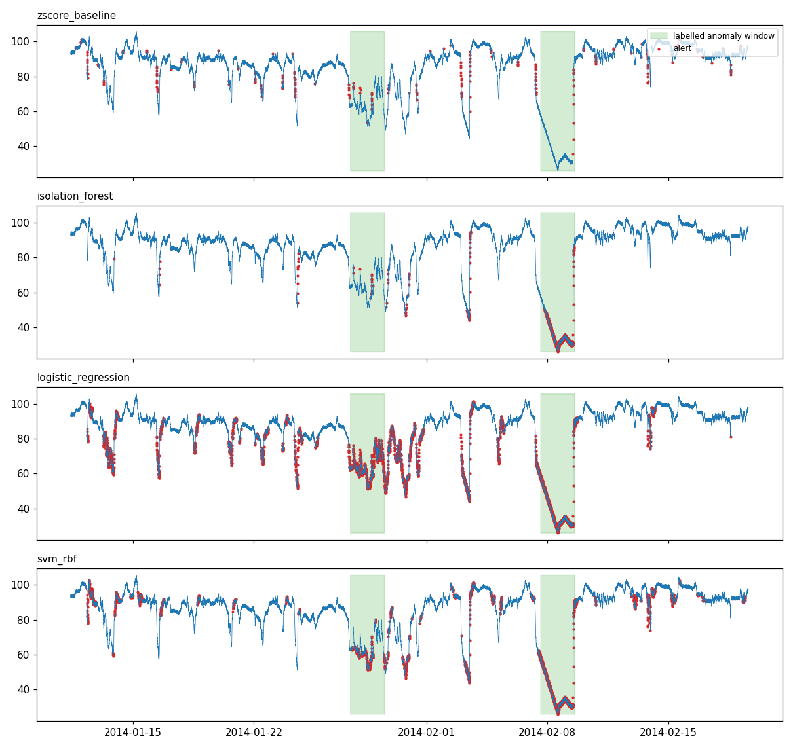

# sensor-anomaly-detection

Time-series anomaly detection on real machine sensor data, built with Pandas, scikit-learn and SQLite.

**Data:** `machine_temperature_system_failure` from the [Numenta Anomaly Benchmark](https://github.com/numenta/NAB)
(NAB, AGPL-3.0): a machine temperature reading every 5 minutes (22,695 readings, Dec 2013 - Feb 2014) with
4 labelled anomaly windows, each about two days long. Data is downloaded, not stored in this repo.

## Pipeline

1. **Load** the series and label every reading inside an anomaly window as 1 (`src/data.py`).
2. **Features** (`src/features.py`): 1-step difference plus rolling mean, std, min, max and z-score over 1-hour and 6-hour windows. Each feature uses only past data (tested for no look-ahead).
3. **Split** chronologically: first 50% train, last 50% test. The time series is never shuffled (`src/evaluate.py`).
4. **Models** (`src/models.py`): rolling z-score baseline, Isolation Forest (unsupervised), Logistic Regression and RBF SVM (supervised, class-balanced). Scalers are fitted on the training part only.
5. **Evaluate** with precision, recall and F1 on the anomaly class, plus how many labelled windows got at least one alert. Accuracy is not used, because 90% of points are normal and "always normal" would score 90%.
6. **Store and query** predictions and metrics in SQLite (`src/db.py`, `sql/queries.sql`: GROUP BY, HAVING, subquery).

## Results (single run, default settings, test period 2014-01-11 to 2014-02-19)

| Model | Precision | Recall | F1 | Alerts | Windows hit |
|---|---|---|---|---|---|
| Isolation Forest | 0.863 | 0.428 | 0.572 | 562 | 2/2 |
| Logistic Regression | 0.338 | 0.996 | 0.505 | 3339 | 2/2 |
| SVM (RBF) | 0.387 | 0.687 | 0.495 | 2011 | 2/2 |
| Z-score baseline | 0.108 | 0.025 | 0.040 | 259 | 2/2 |



Isolation Forest has the best F1 and the fewest false alarms; Logistic Regression catches almost every
labelled point but raises many alerts outside the windows. The baseline fires on short dips and misses most of the
failure windows.

## Limitations

- One series and one chronological split; no cross-validation or hyperparameter tuning (Isolation Forest `contamination=0.02` was set by hand, not tuned on the test set).
- Labels are wide windows, so point-level precision and recall are harsh: an alert just before a window counts as a false positive. "Windows hit" is a looser, more operational view.
- Supervised models see only two labelled windows in training.

## Run

```bash
pip install -r requirements.txt
python scripts/download_data.py
python src/main.py        # trains, evaluates, writes outputs/results.db and outputs/anomalies.png
python src/queries.py     # runs sql/queries.sql on the results
python -m pytest -q
```
